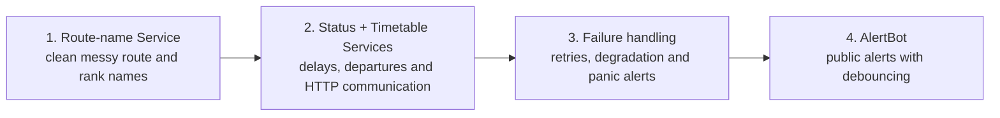

<div align="center">

# 🚌 TransitPulse

**What happens to a public-transport status system when one of its services dies mid-run? I built one to find out.**


</div>

TransitPulse tracks the status of **buses, trains and minibus taxis**.

It is a small distributed system made up of independent services that communicate over HTTP and a message queue. I built it to practise the less glamorous but important parts of systems integration: retries, partial failure, messy data, graceful degradation and avoiding duplicate alerts.

## The system in four steps



Each `iteration-*` folder is a complete runnable snapshot of the project at that stage.

Later iterations include the functionality from the earlier ones, so the repository shows how the system developed step by step.

| Iteration | What it adds | What the demo shows |
|---|---|---|
| **1 — Route-name Service** | Cleans and de-duplicates messy route and rank names | Raw transport data becoming consistent lookups |
| **2 — Status + Timetable** | Independent services communicating over HTTP | Querying buses, trains and taxi ranks |
| **3 — Errors + panic alerts** | Retry with backoff, graceful degradation and panic alerts | The Status Service being stopped mid-run while the rest of the system responds |
| **4 — Public alerts** | AlertBot and debounce logic | Real changes create alerts while rapid repeated changes are suppressed |

## Run it

Run the full system:

```bash
./run.sh
```

Run a specific iteration:

```bash
./run.sh 3
```

Valid iterations are:

```text
1
2
3
4
```

The script uses Maven if it is available and falls back to plain `javac` and `java` if it is not.

If the script is not executable:

```bash
bash run.sh
```

or:

```bash
chmod +x run.sh
./run.sh
```

## Run it manually

### With Maven

```bash
cd iteration-4-public-alerts
mvn compile exec:java
```

### With plain Java

```bash
cd iteration-4-public-alerts

find src -name "*.java" > sources.txt

javac -d out @sources.txt

java -cp out transitpulse.Iteration4Demo
```

You can replace `Iteration4Demo` with:

```text
Iteration1Demo
Iteration2Demo
Iteration3Demo
```

to run an earlier stage.

## What happens when a service fails?

Iteration 3 is where the project becomes more interesting.

The Status Service is deliberately stopped while the rest of the system is running.

Instead of immediately crashing, the client retries the request using backoff.

If the service still cannot be reached, the system degrades gracefully and publishes a panic alert through the message queue.

The goal was not just to make the happy path work. I wanted failure to be part of the demo.

## Public alerts and debouncing

Iteration 4 adds an AlertBot that listens for status changes.

A genuine change should create an alert.

But if a service rapidly switches between states, users should not receive a flood of repeated messages.

The debounce logic suppresses those rapid changes.

For example:

```text
Status changes
      ↓
Alert created
      ↓
Another rapid change
      ↓
Suppressed during debounce window
      ↓
Change after the window
      ↓
New alert created
```

This helped me understand why event-driven systems need to think about more than just sending messages. They also need to control noise.

## Why plain Java?

TransitPulse intentionally does not use Spring Boot or an external web framework.

The services use the Java standard library, including:

```text
com.sun.net.httpserver.HttpServer
java.net.http.HttpClient
```

There is also a small hand-written JSON helper.

I wanted to understand the mechanics of service communication before hiding them behind a framework.

The project requires Java 17 or newer and was built and tested with Java 21.

## Messaging

The project currently uses an in-memory publish/subscribe queue.

Its interface is designed around the same basic publish and subscribe concepts I would use with a real message broker.

That keeps the project dependency-free while still letting me practise event-driven communication.

A future version could replace it with something such as ActiveMQ or RabbitMQ without changing the overall idea of the system.

## Project structure

```text
TransitPulse/
├── iteration-1-route-name-service/
├── iteration-2-status-timetable/
├── iteration-3-errors-panic-alerts/
├── iteration-4-public-alerts/
└── run.sh
```

Each iteration is independently runnable.

## What I learned

### Failure is part of system design

A distributed system cannot assume every service will always be available.

Retries, timeouts and graceful degradation need to be considered as part of the normal system flow.

### Messaging reduces direct coupling

Publishing an event allows another part of the system to react without requiring one service to directly call another.

### More messages are not always better

The AlertBot showed me why debouncing matters.

A technically correct system can still create a bad experience if it overwhelms users with repeated notifications.

### Frameworks solve problems I can now see

Building the HTTP communication with the JDK made some of the conveniences provided by frameworks much easier to appreciate.

## Known limitations

- The message queue is in-memory rather than a real external broker.
- Data is stored in memory, so every demo starts fresh.
- Route-name title casing is still naive for some South African place names.
- There is no persistent database yet.

One known example is:

```text
KwaZulu-Natal
```

which can currently become:

```text
Kwazulu-natal
```

That casing behaviour is on the fix list.

## Tech stack

| Area | Technology |
|---|---|
| **Language** | Java 21 |
| **HTTP server** | JDK `HttpServer` |
| **HTTP client** | JDK `HttpClient` |
| **Messaging** | In-memory publish / subscribe queue |
| **Build** | Maven or plain `javac` |
| **Data** | In-memory |
| **Architecture** | Independent services, HTTP and event-driven communication |

## What's next

- [ ] Add unit tests for retry-with-backoff
- [ ] Add unit tests for debounce behaviour
- [ ] Fix South African place-name title casing
- [ ] Replace the in-memory queue with a real message broker
- [ ] Add PostgreSQL persistence
- [ ] Record a terminal demo showing Iteration 3 failure handling

---

<p align="center">Built by <a href="https://github.com/ZinhleHlongwane">Zinhle Hlongwane</a> · Johannesburg 🇿🇦 · <a href="https://www.linkedin.com/in/zinhle-hlongwane-872354209">LinkedIn</a></p>
