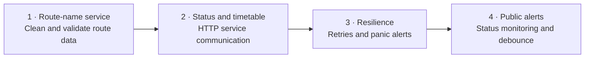

<div align="center">

# 🚌 TransitPulse

**What happens to a public-transport status system when one of its services fails mid-run? I built one to find out.**


</div>

TransitPulse is a small public-transport information system for buses, trains and minibus taxis. It brings together independent Java services that communicate over HTTP and an in-memory publish/subscribe queue.

I built it to explore the parts of systems integration that are easy to overlook when everything works: inconsistent input data, service failures, retries, partial results, event delivery and avoiding repeated public alerts.

The repository has two purposes:

- **Iterations 1–4** preserve the progression of the original WeThinkCode_ project. Each folder is a runnable snapshot from a particular stage.
- **final-system/** is reserved for a cleaned-up implementation that will bring the ideas together without changing the historical iterations. It is currently a planning scaffold; the integrated implementation has not been built yet.

## How the system developed



| Stage | Focus | What it demonstrates |
|---|---|---|
| [Iteration 1](iteration-1-route-name-service/) | Route-name service | Cleans and de-duplicates route and rank data |
| [Iteration 2](iteration-2-status-and-timetable-services/) | Status and timetable | Separate services communicating over HTTP |
| [Iteration 3](iteration-3-error-handling-and-panic-alerts/) | Failure handling | Retry with backoff, graceful degradation and panic alerts |
| [Iteration 4](iteration-4-public-alerts/) | Public alerts | Status-change events, an AlertBot and debounce behaviour |

The later snapshots contain the earlier functionality as it stood at that point. They are intentionally kept separate so the original development history remains inspectable.

## Run a coursework iteration

You need Java 17 or newer. The project was developed with Java 21. Maven is optional.

Run the latest coursework iteration:

```bash
./run.sh
```

Run a specific iteration:

```bash
./run.sh 1
./run.sh 2
./run.sh 3
./run.sh 4
```

If the script is not executable:

```bash
bash run.sh 4
```

The runner uses Maven when it is available and otherwise falls back to `javac` and `java`.

You can also run Iteration 4 manually:

```bash
cd iteration-4-public-alerts
mvn compile exec:java
```

Or without Maven:

```bash
find src -name "*.java" > sources.txt
javac -d out @sources.txt
java -cp out transitpulse.Iteration4Demo
```

## A closer look at the integration work

### Service communication

The services use the JDK HTTP server and client APIs. This keeps the examples small and makes the request/response flow visible without introducing a web framework.

### Handling an unavailable service

Iteration 3 wraps the status client with retry and backoff behaviour. If the dependency remains unavailable, the client returns an empty result and publishes a panic alert rather than allowing the failure to crash the calling flow.

### Turning status changes into public alerts

Iteration 4 adds a monitor that publishes status-change events. AlertBot subscribes to those events and applies a debounce window so rapid status changes do not flood the public feed.

The public publisher in this iteration writes to the console. It is an integration point for a future real notification provider, not a live social-media integration.

## Architecture and design notes

The iteration snapshots are intentionally preserved. The planned final implementation will have one source tree, clear boundaries between domain logic, HTTP adapters and messaging, and a single build/test entry point.

See [the architecture and cleanup plan](docs/architecture.md) for the proposed boundaries and the order of work.

## Technology

| Area | Technology |
|---|---|
| Language | Java |
| Runtime target | Java 17+ (developed with Java 21) |
| HTTP server/client | JDK `HttpServer` and `HttpClient` |
| Messaging | Custom in-memory publish/subscribe queue |
| Build | Maven or plain `javac` |
| Data | In-memory demo data |
| Integration style | HTTP request/response and event-driven messaging |

## Current limitations

- The message queue is in-memory; it is not RabbitMQ, ActiveMQ or another external broker.
- Demo data and status are held in memory and reset when the application restarts.
- Public alerts are printed to the console; no external notification platform is connected.
- There is no persistent database.
- Route-name title casing is basic and does not preserve every South African place-name convention.
- The iteration snapshots are separate runnable versions, not yet one consolidated production-style application.
- Automated unit and integration test coverage still needs to be established.

## What I want to improve next

- [x] Preserve the four original iteration snapshots.
- [x] Document what each iteration demonstrates.
- [ ] Establish a clean final-system source structure.
- [ ] Consolidate the service implementations without changing their behaviour.
- [ ] Add focused tests for route cleaning, HTTP behaviour, retries and debounce logic.
- [ ] Improve configuration, lifecycle management and error reporting.
- [ ] Evaluate replacing the in-memory queue with a real broker.
- [ ] Evaluate persistence for route and status data.

---

<p align="center">Built by <a href="https://github.com/ZinhleHlongwane">Zinhle Hlongwane</a> · Johannesburg 🇿🇦 · <a href="https://www.linkedin.com/in/zinhle-hlongwane-872354209">LinkedIn</a></p>
